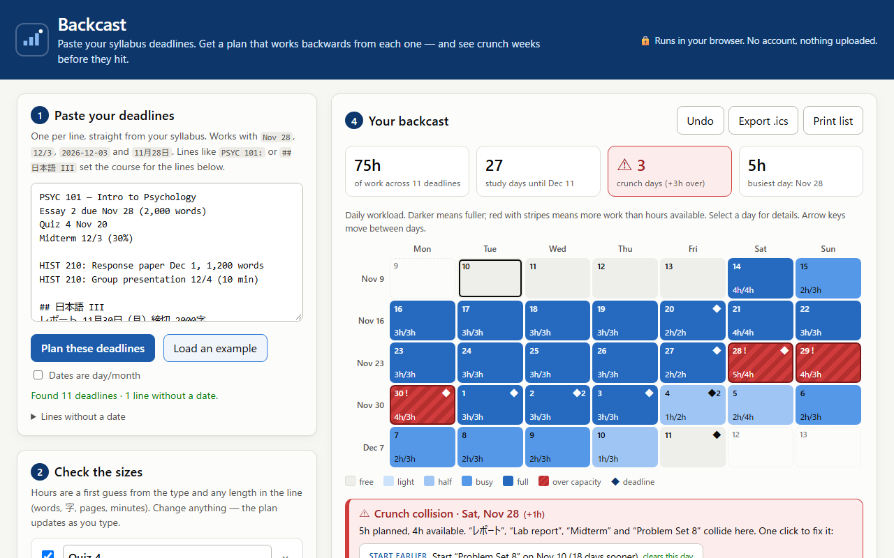
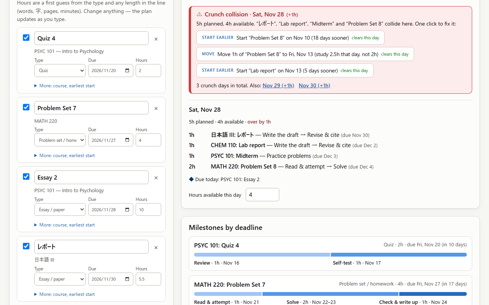
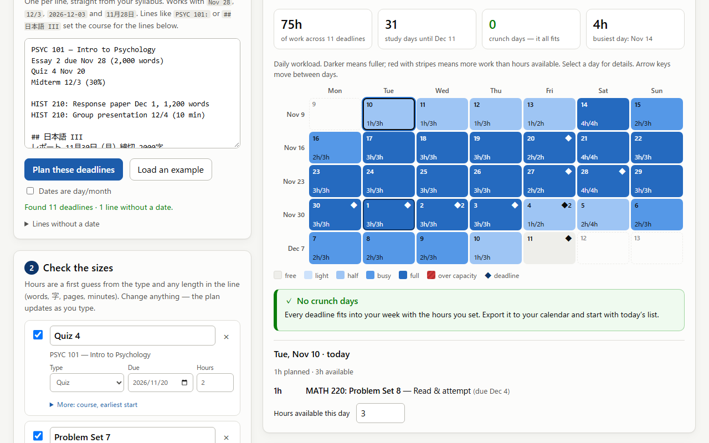

# Backcast — plan backwards from every deadline

**Live demo:** https://class-now.github.io/backcast-planner/ · **Video (73 s):** see `submission/demo.mp4` / the Devpost page · **License:** MIT

Paste the deadlines from your syllabi. Backcast reads them (English or Japanese dates), sizes each one by type, plans the work **backwards** from each deadline into the days before it, and shows a workload heatmap that flags **crunch collisions** — days where more work is due than you have hours for — with one-click fixes. Export the plan to your calendar (.ics) or print it as a checklist.

Everything runs in your browser. No account, no server, no network requests; your plan is saved in `localStorage` only.



## The problem

A syllabus tells you *when* things are due, not *when to start*. Students see "Essay 2 — Nov 28" and "Midterm — Dec 3" on two different course pages and only notice on Nov 26 that they collide with a lab report and a problem set in the same four days. Calendars show deadlines as single dots; to-do apps show lists. Neither shows the **load** in the days *before* the deadlines, which is where the trouble actually is.

This is a well-documented pattern, not just our experience:

- **Planning fallacy** — people consistently underestimate how long their own tasks take, even when they know similar tasks ran late before (Buehler, Griffin & Ross, 1994, *Journal of Personality and Social Psychology* 67(3)).
- **Procrastination is the norm in college** — Steel's 2007 meta-analysis (*Psychological Bulletin* 133(1)) reports estimates that 80–95% of college students procrastinate.

Backcast attacks both: it puts an explicit hour estimate on every deadline (so the size is visible and editable), and it makes the overlap visible weeks ahead, while "start earlier" is still a real option.

## Who it is for

University and high-school students juggling several courses — especially in the busy weeks around midterms and finals — who already have their deadlines in syllabi or a learning-management system but no picture of their weekly workload. It also works for Japanese students (dates like `11月28日（月）`, words like レポート・小テスト・課題 are understood).

## How to use it

1. **Paste your deadlines**, one per line (or click *Load an example*). Lines like `PSYC 101:` or `## 日本語 III` set the course for the lines below them. Lines without a date are listed so you can see what was skipped.
2. **Check the sizes.** Each deadline gets a type (essay, exam, quiz, problem set, presentation, project, reading, other) and an hour estimate. Change anything; the plan updates as you type.
3. **Set your week** — how many hours you can really study each weekday — and the session length.
4. **Read the heatmap.** Darker = fuller day; red with stripes = over capacity. Select a day to see exactly what to work on. Crunch days come with fixes:
   - **Start earlier** — move the task's start date back (smallest shift that clears the day),
   - **Move** — move the extra hours to a lighter day by studying a bit more on that day,
   - **Shrink** — cut the task's hours (never more than half).
   Every suggested fix is verified by re-running the planner before it is shown, and every change can be undone.
5. **Export** an `.ics` file (Google / Apple / Outlook Calendar) or **print** the day-by-day checklist.

Tip: add `?today=YYYY-MM-DD` to the URL to plan as if it were another day (used for the demo and screenshots).

## Before / after (the built-in example)

**Before** — what a student pastes (fictional courses):

```
PSYC 101 — Intro to Psychology
Essay 2 due Nov 28 (2,000 words)
Quiz 4 Nov 20
Midterm 12/3 (30%)
HIST 210: Response paper Dec 1, 1,200 words
## 日本語 III
レポート 11月30日（月）締切 2000字
MATH 220 Problem Set 8 due Dec 4
CHEM 110 Lab report due Dec 2 (4 pages)
…
```

**After** — on Nov 10 Backcast reports: 11 deadlines, 75 h of work, and **3 crunch days (Nov 28–30, +3 h over)** where the report, the lab report, the midterm and a problem set all need the same weekend. One click on *Start "Problem Set 8" on Nov 10* re-plans it: 0 crunch days, every task finished before its deadline, each split into dated milestones (e.g. Essay 2: *Research & outline* Nov 14 → *Write the draft* Nov 14–18 → *Revise & cite* Nov 19–21 → *Final read-through* Nov 21 — a week of slack before Nov 28).

| Crunch found, with fixes | After one click |
|---|---|
|  |  |

## How it works

- **Parser** (`js/parser.js`): normalises the text (NFKC, so full-width digits work), finds the first date in each line by priority — ISO `2026-12-03`, Japanese `2026年12月3日` / `12月3日`, `Nov 28` / `November 28th, 2026`, `28 Nov`, numeric `12/3` (month/day by default, a *day/month* switch, and automatic swap when the first number can't be a month). A date with no year is placed in the current year unless that is more than 60 days in the past (then next year). The type comes from keyword rules in both languages; hours come from the type plus size hints (words, 字, pages, minutes, % weight, "final").
- **Scheduler** (`js/scheduler.js`): each task may be worked on from `due − lead days` (per type, editable) to the day before it is due. Tasks are placed in deadline order; each session goes to the day in the window that ends up least full relative to its capacity, so load is spread and the last days stay free. A repair pass moves another task's session to a free day when that makes room. Anything that still doesn't fit lands on the least-bad day and is reported as overload. Hours are then split, in date order, into the type's milestones.
- **Fixes**: `suggestFixes` tries start-date shifts, cuts and "move" (extra hours on a chosen lighter day), re-runs the scheduler for each candidate, and keeps only those that reduce the overload on that day *and* overall.
- **Export** (`js/ics.js`): RFC 5545 all-day events (one per task per work day, one per deadline), escaped and folded at 75 octets.
- **UI** (`js/app.js`): vanilla JS modules, no build, no dependencies. Heatmap is a real `<table>` of buttons with full spoken labels, arrow-key navigation, and colour + stripes + "!" so it never relies on colour alone.

## Run it locally

No build step. Any static server works:

```bash
git clone https://github.com/Class-now/backcast-planner
cd backcast-planner
node scripts/serve.mjs        # http://127.0.0.1:8731/
npm test                      # unit tests: parser, scheduler, .ics (node --test)
```

End-to-end check and the submission assets (needs `npm install` for Playwright, headless Chromium):

```bash
node scripts/smoke.mjs        # parse → heatmap → fix → undo → keyboard → reload → .ics → print → 360px phone
node scripts/screenshots.mjs  # submission/screenshots/*.png
node scripts/record-demo.mjs && node scripts/edit-demo.mjs   # submission/demo.mp4 + transcript.md (needs ffmpeg)
```

## Limitations (honest list)

- **Hour estimates are rules of thumb**, not learned from data (e.g. essay ≈ 2 h + 1 h per 250 words). They are a starting point you are expected to edit.
- **One date per line.** A line with two dates ("Exam 1: 10/15, Exam 2: 11/20") gives only the first; use one line or a `;` per deadline. Relative dates ("next Friday", "week 9") and date ranges are not understood. Ambiguous `3/4` is read month-first unless you tick *Dates are day/month*.
- **The scheduler is a greedy heuristic with one repair pass**, not an optimal solver; in rare tight cases it can report a crunch that a perfect rearrangement could avoid. It plans in whole days (no time-of-day blocks) and doesn't know about your classes or other commitments beyond the weekly hours you enter.
- **No sync.** Data lives in one browser's localStorage; clearing site data or switching devices loses it (export the .ics to keep a copy).
- **Not user-tested yet.** The evidence of need above is from published research and our own experience as students; we have not run a study with Backcast users.
- English UI only (Japanese input is supported).

## Built during LaunchPad Hacks (Oct 16 – Nov 20, 2026)

All code, design, tests, screenshots and the demo video in this repository were created from scratch on **2026-11-10**, inside the hackathon period. There is no earlier version. The git history shows every commit.

## Credits

- **AI assistance:** built with **Claude Code** (Anthropic's Claude) as a coding assistant — it wrote most of the code, tests and documentation under our direction, and we reviewed and tested the results.
- Heatmap colours follow a validated sequential blue ramp and a separate "critical" red; icons are Unicode characters. No third-party code or assets are shipped; Playwright and ffmpeg are used only offline to test and record the demo.
- Research cited: Buehler, R., Griffin, D., & Ross, M. (1994). *Exploring the "planning fallacy"*. JPSP 67(3), 366–381. Steel, P. (2007). *The nature of procrastination*. Psychological Bulletin 133(1), 65–94.
- All example courses and deadlines are fictional.
